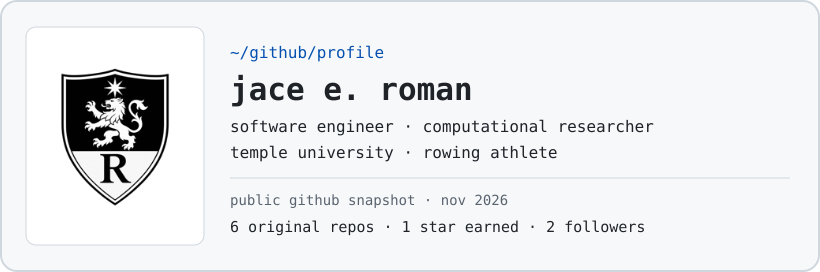

<a href="https://z5rcnws7bz-eng.github.io/jace-portfolio/">
  <picture>
    <source media="(prefers-color-scheme: dark)" srcset="https://raw.githubusercontent.com/z5rcnws7bz-eng/z5rcnws7bz-eng/main/assets/dark_mode.svg">
    
  </picture>
</a>

[Portfolio](https://z5rcnws7bz-eng.github.io/jace-portfolio/) · [Projects](https://github.com/z5rcnws7bz-eng?tab=repositories) · [Contact](mailto:jace.roman@temple.edu)

<!-- The theme cards are in assets/light_mode.svg and assets/dark_mode.svg. -->
<!-- Profile card format inspired by https://github.com/Andrew6rant/Andrew6rant. -->
